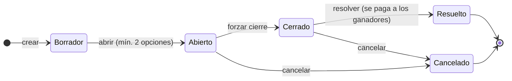

<div align="center">


### Plataforma de apuestas universitarias con puntos ficticios

</div>

---

**UEx365** es una aplicación web en la que los estudiantes apuestan **puntos ficticios** sobre lo que ocurre en la vida universitaria: aprobados de un examen, el torneo de fútbol sala, si se acabarán los croissants de la cafetería… Los usuarios compiten en un ranking, giran una ruleta diaria y canjean sus puntos en una tienda. Los administradores crean, abren, cierran y resuelven los eventos.

> [!IMPORTANT]
> Proyecto académico desarrollado para una asignatura universitaria. **No se usa dinero real**: todo funciona con puntos sin valor económico. El nombre y la estética son una parodia sin relación con ninguna casa de apuestas ni institución.

## Índice

- [Autores](#autores)
- [Funcionalidades](#funcionalidades)
- [Tecnologías](#tecnologías)
- [Estructura del proyecto](#estructura-del-proyecto)
- [Requisitos previos](#requisitos-previos)
- [Instalación y puesta en marcha](#instalación-y-puesta-en-marcha)
- [Variables de entorno](#variables-de-entorno)
- [Datos iniciales](#datos-iniciales)
- [Gestión de usuarios](#gestión-de-usuarios)
- [Uso de la aplicación](#uso-de-la-aplicación)
- [API](#api)
- [Solución de problemas](#solución-de-problemas)
- [Estado del proyecto](#estado-del-proyecto)
- [Licencia](#licencia)

## Autores

La versión base de este proyecto se desarrolló como trabajo de la asignatura
Ingeniería Web del grado de Ingeniería Informática en Ingeniería del Software de la Universidad de Extremadura (curso 2025/26). El proyecto fue realizado por:

- **Alberto Chamizo Barrio** — [@AlbertooCh](https://github.com/AlbertooCh)
- **Lucas Méndez Fernández** — [@thelucasmen2](https://github.com/thelucasmen2)
- **Javier Crespo Gómez** — [@javiercresp](https://github.com/javiercresp)
- **Sergio Durán Pérez** — [@SergioDP2003](https://github.com/SergioDP2003)

A partir de esa versión, [@SergioDP2003](https://github.com/SergioDP2003) mantiene una versión independiente del proyecto y su propia evolución.

## Funcionalidades

**Usuarios**

- Registro e inicio de sesión con usuario y contraseña, o con Google (opcional).
- Saldo inicial de **300 puntos** al registrarse.
- Catálogo de eventos abiertos y detalle con sus opciones y cuotas.
- **Carrito de apuestas**: apuestas simples o **combinadas** (las cuotas se multiplican).
- Historial de apuestas con su estado y resultado.
- **Ruleta diaria**: entre 1 y 10 puntos gratis cada 24 horas.
- **Tienda de canje**: cambia puntos por productos.
- **Perfil** con estadísticas (tasa de acierto, beneficio neto, transacciones…).
- **Ranking global** ordenado por beneficio neto.

**Administradores**

- Panel de administración propio dentro de la web.
- CRUD de usuarios, eventos, opciones, categorías, productos de canje y transacciones.
- Ciclo de vida de los eventos: abrir, forzar cierre, resolver (paga a los ganadores) y cancelar (devuelve lo apostado).
- Ajustes manuales de saldo mediante transacciones.

## Tecnologías

| Capa | Tecnología |
|---|---|
| **Backend** | Python 3.12 · Django 5.0 · Django REST Framework · SimpleJWT · django-cors-headers · drf-spectacular · google-auth |
| **Frontend** | React 19 · Vite 8 · React Router 7 · @react-oauth/google · CSS propio |
| **Base de datos** | SQLite |

## Estructura del proyecto

```
proyecto-uex365/
├── backend/                 API REST (Django)
│   ├── uex365/              Configuración del proyecto (settings, urls)
│   ├── user/                Usuarios, autenticación, perfil y ranking
│   ├── event/               Eventos, opciones, categorías y estados
│   │   └── management/commands/seed_data.py   Script de datos iniciales
│   ├── bet/                 Apuestas y apuestas combinadas (SemiBet)
│   ├── cart/                Carrito de apuestas (en la sesión) y checkout
│   ├── transaction/         Movimientos de puntos
│   ├── exchange/            Tienda: productos y canjes
│   ├── roulette/            Ruleta diaria
│   ├── requirements.txt
│   └── .env.example
└── frontend/                Aplicación web (React + Vite)
    ├── src/
    │   ├── pages/           Vistas (públicas, usuario y admin)
    │   ├── components/      Componentes reutilizables (layout, admin, auth…)
    │   ├── config/          Definición de las entidades del panel de admin
    │   ├── services/        Llamadas a la API
    │   └── styles/          Hojas de estilo
    ├── package.json
    └── .env.example
```

Cada app del backend sigue la misma organización: `models` → `serializers` → `controller` (lógica de negocio) → `views` → `urls`.

## Requisitos previos

| Herramienta | Versión |
|---|---|
| [Python](https://www.python.org/downloads/) | 3.12 o superior |
| [Node.js](https://nodejs.org/) | 20.19+ o 22.12+ (lo exige Vite 8) |
| npm | Incluido con Node.js |
| Git | Cualquier versión reciente |

## Instalación y puesta en marcha

Los comandos están escritos para **Windows (PowerShell)**. Si usas macOS o Linux, despliega el bloque correspondiente en cada paso.

### 1. Clonar el repositorio

```bash
git clone <url-del-repositorio>
cd proyecto-uex365
```

### 2. Backend

**2.1. Crear y activar el entorno virtual** (desde la raíz del proyecto)

```powershell
python -m venv venv
Set-ExecutionPolicy -Scope Process -ExecutionPolicy RemoteSigned
.\venv\Scripts\Activate.ps1
```

<details>
<summary>macOS / Linux</summary>

```bash
python3 -m venv venv
source venv/bin/activate
```
</details>

Verás `(venv)` al principio de la línea de la terminal. Para salir del entorno, usa `deactivate`.

**2.2. Instalar dependencias**

```powershell
cd backend
pip install -r requirements.txt
```

**2.3. Configurar las variables de entorno**

```powershell
Copy-Item .env.example .env
```

<details>
<summary>macOS / Linux</summary>

```bash
cp .env.example .env
```
</details>

Genera una clave secreta y pégala en `DJANGO_SECRET_KEY` dentro de `backend/.env`:

```powershell
python -c "from django.core.management.utils import get_random_secret_key; print(get_random_secret_key())"
```

El resto de variables se explican en [Variables de entorno](#variables-de-entorno).

**2.4. Crear la base de datos y cargar los datos iniciales**

```powershell
python manage.py migrate
python manage.py seed_data
```

**2.5. Crear tu usuario administrador**

```powershell
python manage.py createsuperuser
```

Más detalles en [Gestión de usuarios](#gestión-de-usuarios).

**2.6. Arrancar el servidor**

```powershell
python manage.py runserver
```

El backend queda disponible en **http://localhost:8000**.

### 3. Frontend

En **otra terminal**, desde la raíz del proyecto:

```powershell
cd frontend
npm install
Copy-Item .env.example .env
npm run dev
```

<details>
<summary>macOS / Linux</summary>

```bash
cd frontend
npm install
cp .env.example .env
npm run dev
```
</details>

La web queda disponible en **http://localhost:5173**.

> [!IMPORTANT]
> Abre la web en `http://localhost:5173` y **no** en `http://127.0.0.1:5173`. El backend solo acepta peticiones (CORS) desde `localhost:5173`, y el carrito depende de la cookie de sesión de ese origen.

### Arranques posteriores

Una vez instalado, solo necesitas dos terminales:

| Terminal 1: backend | Terminal 2: frontend |
|---|---|
| `.\venv\Scripts\Activate.ps1`<br>`cd backend`<br>`python manage.py runserver` | `cd frontend`<br>`npm run dev` |

Para detener cualquiera de los dos, pulsa `Ctrl + C`.

## Variables de entorno

Los archivos `.env` **no se suben al repositorio**. Cada persona crea los suyos a partir de los `.env.example`.

### `backend/.env`

| Variable | Obligatoria | Descripción | Ejemplo |
|---|:---:|---|---|
| `DJANGO_SECRET_KEY` | ✅ | Clave secreta de Django. Genera una propia (ver paso 2.3). | `k#9x...` |
| `DJANGO_DEBUG` | — | Modo depuración. Por defecto `False`; en desarrollo usa `True`. | `True` |
| `DJANGO_ALLOWED_HOSTS` | — | Hosts permitidos, separados por comas. | `localhost,127.0.0.1` |
| `GOOGLE_CLIENT_ID` | Solo para login con Google | Client ID de OAuth de Google. | `xxxx.apps.googleusercontent.com` |

### `frontend/.env`

| Variable | Obligatoria | Descripción |
|---|:---:|---|
| `VITE_GOOGLE_CLIENT_ID` | Solo para login con Google | El mismo Client ID que en el backend. |

> [!TIP]
> Vite solo lee el `.env` al arrancar. Si lo modificas, reinicia `npm run dev`.

<details>
<summary><b>Cómo obtener un Google Client ID (opcional)</b></summary>

1. Entra en [Google Cloud Console](https://console.cloud.google.com/) y crea un proyecto.
2. Ve a **APIs y servicios → Pantalla de consentimiento de OAuth** y configúrala (tipo *Externo*).
3. Ve a **Credenciales → Crear credenciales → ID de cliente de OAuth → Aplicación web**.
4. En **Orígenes autorizados de JavaScript** añade `http://localhost:5173` y `http://localhost`.
5. Copia el Client ID en `GOOGLE_CLIENT_ID` (backend) y en `VITE_GOOGLE_CLIENT_ID` (frontend).

Sin esta configuración, la aplicación funciona igual; solo el botón de Google no estará operativo.
</details>

## Datos iniciales

El comando `seed_data` deja la aplicación lista para usarse con contenido de ejemplo:

```powershell
python manage.py seed_data
```

| Qué crea | Detalle |
|---|---|
| **Catálogos internos** | Estados de evento, estados y tipos de apuesta, tipos de transacción, estados de canje, estados de usuario y el grupo *Administradores*. Son **imprescindibles**: la lógica del backend depende de sus IDs. |
| **Categorías** | Académico, Deportivo, Campus, Tecnología y Cultura. |
| **Eventos** | 10 eventos con sus opciones y cuotas: 8 **abiertos** para apostar, 1 en **borrador** (para probar "Abrir evento") y 1 **cerrado** (para probar "Resolver evento"). |
| **Productos de canje** | 6 productos para la tienda (5 activos y 1 inactivo). |

- **No crea usuarios.** Cada persona gestiona los suyos (ver la sección siguiente).
- **Se puede ejecutar tantas veces como se quiera.** No duplica datos y no modifica los eventos ni productos que ya existan.

> [!NOTE]
> Los eventos de ejemplo tienen fechas de cierre en **2050**, a propósito. Los eventos **no se cierran solos** al llegar esa fecha: el cierre lo hace un administrador desde el panel.

### Empezar de cero

Para borrar todos los datos y volver al estado inicial:

```powershell
Remove-Item db.sqlite3
python manage.py migrate
python manage.py seed_data
python manage.py createsuperuser
```

## Gestión de usuarios

El repositorio **no incluye ningún usuario ni contraseña**. Tras instalar, cada persona crea los suyos.

### Administrador

```powershell
python manage.py createsuperuser
```

Con ese usuario puedes:

- Entrar en la web (`http://localhost:5173/login`). Al ser administrador, se te redirige al **panel de administración** (`/admin`).
- Entrar en el **admin de Django** (`http://localhost:8000/admin/`) para gestionar cualquier tabla directamente.

Un usuario se considera administrador si cumple cualquiera de estas condiciones:

- Es *superusuario*.
- Tiene marcado *Staff*.
- Pertenece al grupo *Administradores*.

### Usuarios normales

- **Registro desde la web**: `http://localhost:5173/register`. Cada cuenta nueva empieza con 300 puntos.
- **Desde el panel de administración** de la web: *Gestionar usuarios → + Nuevo usuario*.
- **Desde el admin de Django**: *Users → Añadir*.

### Convertir un usuario en administrador

- **Admin de Django**: *Users* → elige el usuario → marca **Staff status** → Guardar.
- **Panel de la web**: *Gestionar usuarios* → *Editar* → marca **Es Administrador (Staff)**.

> [!TIP]
> Para probar el ranking y las apuestas entre varios usuarios, registra dos o tres cuentas desde `/register` y apuesta con cada una.

## Uso de la aplicación

### Direcciones

| Dirección | Contenido |
|---|---|
| http://localhost:5173 | Aplicación web |
| http://localhost:5173/admin | Panel de administración (solo administradores) |
| http://localhost:8000/admin/ | Admin de Django |
| http://localhost:8000/docs/ | Documentación interactiva de la API (Swagger) |
| http://localhost:8000/redoc/ | Documentación de la API (ReDoc) |

### Ciclo de vida de un evento



- **Borrador**: el evento no es visible para los usuarios. Se le añaden opciones con su cuota.
- **Abierto**: los usuarios pueden apostar.
- **Cerrado**: no se admiten más apuestas y el evento queda pendiente de resultado.
- **Resuelto**: el administrador marca las opciones ganadoras. Cada apuesta acertada se paga como `importe × cuota`. Una combinada se resuelve cuando todos sus eventos están resueltos, y solo gana si aciertan todas sus opciones.
- **Cancelado**: se devuelve el importe de las apuestas pendientes.

### Flujo de una apuesta

1. En **Todos los eventos**, entra en un evento abierto.
2. Pulsa **Nueva apuesta** en una opción (apuesta simple) o **Añadir** para sumarla a una apuesta del carrito (combinada).
3. En el **Carrito**, indica la cantidad de cada apuesta (mínimo 1 punto) y pulsa **Finalizar apuesta**.
4. Consulta el resultado en **Historial de apuestas** cuando el administrador resuelva el evento.

## API

La API REST se sirve en `http://localhost:8000` y se autentica con **JWT**: se envía la cabecera `Authorization: Bearer <access_token>`. La referencia completa de endpoints está en **`/docs/`**.

| Grupo | Endpoints principales |
|---|---|
| Autenticación | `POST /api/register/` · `POST /api/login/` · `POST /api/token/refresh/` · `POST /api/google-login/` · `POST /api/logout/` |
| Perfil | `GET/PATCH /api/me/` · `GET /me/stats/` · `GET /ranking/` |
| Eventos | `/event/` · `/event/available/` · `/event/{id}/detail/` · `/event/{id}/open/` · `/event/{id}/force_close/` · `/event/{id}/resolve/` · `/event/{id}/cancel/` |
| Opciones y categorías | `/option/` · `/event_category/` · `/event_state/` |
| Carrito | `GET /cart/` · `POST /cart/add/` · `POST /cart/add-option/` · `DELETE /cart/bet/{bet_id}/option/{option_id}/` · `DELETE /cart/clear/` · `POST /cart/checkout/` |
| Apuestas | `/bet/` · `/bet/user/{id}/` · `/semibet/` · `/bet_state/` · `/bet_type/` |
| Transacciones | `/transaction/` · `/transaction_type/` |
| Tienda | `/exchange_product/` · `/exchange_product/available/` · `/exchange/` · `/exchange_status/` |
| Ruleta | `POST /roulette/spin/` |
| Usuarios | `/user/` · `/user_state/` · `/group/` |

## Scripts útiles

| Ubicación | Comando | Descripción |
|---|---|---|
| `backend/` | `python manage.py runserver` | Arranca la API en el puerto 8000 |
| `backend/` | `python manage.py seed_data` | Carga los catálogos y datos de ejemplo |
| `backend/` | `python manage.py createsuperuser` | Crea un administrador |
| `backend/` | `python manage.py check` | Comprueba la configuración del proyecto |
| `frontend/` | `npm run dev` | Arranca la web en modo desarrollo |
| `frontend/` | `npm run build` | Genera la versión de producción en `dist/` |
| `frontend/` | `npm run lint` | Analiza el código con ESLint |

## Solución de problemas

<details>
<summary><b><code>KeyError: 'DJANGO_SECRET_KEY'</code> al arrancar el backend</b></summary>

No existe `backend/.env` o le falta la variable. Repite el paso 2.3 y comprueba que el archivo está dentro de `backend/`.
</details>

<details>
<summary><b>PowerShell no permite activar el entorno virtual</b></summary>

Ejecuta antes `Set-ExecutionPolicy -Scope Process -ExecutionPolicy RemoteSigned`. Solo afecta a la terminal actual.
</details>

<details>
<summary><b>La web no carga datos o aparecen errores de CORS en la consola</b></summary>

- Comprueba que el backend está arrancado en el puerto **8000**. El frontend lo busca en `http://localhost:8000`.
- Abre la web en `http://localhost:5173`, no en `127.0.0.1`.
</details>

<details>
<summary><b>El carrito aparece vacío después de añadir apuestas</b></summary>

El carrito se guarda en la sesión del navegador. Usa siempre `localhost` (no `127.0.0.1`) y no bloquees las cookies de `localhost`.
</details>

<details>
<summary><b>No hay eventos en la web, o resolver o cancelar un evento da error</b></summary>

Falta ejecutar `python manage.py seed_data`. Sin los catálogos internos, algunas operaciones fallan.
</details>

<details>
<summary><b>El botón de "Iniciar sesión con Google" no funciona</b></summary>

Configura `GOOGLE_CLIENT_ID` y `VITE_GOOGLE_CLIENT_ID` (ver [Variables de entorno](#variables-de-entorno)), autoriza `http://localhost:5173` en Google Cloud Console y reinicia ambos servidores.
</details>

<details>
<summary><b><code>DisallowedHost</code> al acceder al backend</b></summary>

Añade el host que estés usando a `DJANGO_ALLOWED_HOSTS` en `backend/.env`.
</details>

## Estado del proyecto

Esta es la **versión base** del proyecto académico, publicada como punto de partida para una reestructuración y mejora progresivas. Está pensada para ejecutarse **en local** y **no está preparada para producción**:

- Varios endpoints de la API todavía no restringen el acceso por rol.
- Se usa SQLite y el servidor de desarrollo de Django.
- Los eventos no se cierran automáticamente al llegar su fecha de cierre.
- No hay tests automatizados.

## Licencia

El código fuente se distribuye bajo la **licencia MIT**. Consulta el archivo [LICENSE.md](LICENSE.md) para ver el texto completo.

La licencia cubre **únicamente el código**. Los logotipos e imágenes de `frontend/src/assets/` (`uex365.png`, `uex364_letras.png` y `EscuelaLudopata.png`) quedan **excluidos**: son parodias creadas con fines académicos y se inspiran en marcas de terceros. Si reutilizas el proyecto, sustitúyelos por imágenes propias.
